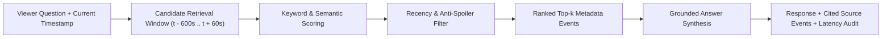

# AI Content Engine & RAG Grounding Specification

This document details the architecture, retrieval pipeline, and grounding guarantees for the **AI Content Engine** in Netflix Watch Spaces, conforming to PRD Section 6.2 (Epic 2) and Section 7.1.

---

## 1. Engine Mission & Boundaries

The AI Content Engine operates as a service-level persona (**AI Co-Pilot**) that:
1. Continuously tracks the group's current video playback timestamp ($t_{\text{current}}$).
2. Retrieves relevant metadata entries within an active temporal window.
3. Generates **retrieval-grounded** responses citing specific timeline source IDs (e.g. `evt_2291`, `evt_3118`).
4. Proactively surfaces trivia cards at scene boundaries.
5. Manages pre-approved variation points (alternate localized subtitles and scene options) via group voting.

> [!IMPORTANT]
> **Anti-Hallucination Boundary**: The AI Co-Pilot only generates responses grounded in pre-authored, verified timeline metadata. It never fabricates plot details, rewrites narrative facts, or generates open-ended fiction. When no verified metadata corresponds to a viewer's question, it explicitly declines or hedges gracefully.

---

## 2. Retrieval-Augmented Generation (RAG) Architecture



### 2.1 Retrieval Scoring Algorithm
For query tokens $Q = \{q_1, q_2, \dots, q_m\}$ and candidate timeline event $E$ with text $T_E$ and timestamp $t_E$:

$$\text{Score}(E, Q, t_{\text{current}}) = 3.0 \cdot |Q \cap T_E| + \text{ProximityBonus}(t_E, t_{\text{current}}) - \text{SpoilerPenalty}(t_E, t_{\text{current}})$$

Where:
- $\text{ProximityBonus} = 2.0$ if $0 \le t_{\text{current}} - t_E < 180\text{s}$ (happened in last 3 minutes).
- $\text{ProximityBonus} = 1.0$ if $180\text{s} \le t_{\text{current}} - t_E < 600\text{s}$.
- $\text{SpoilerPenalty} = 1.0$ if $t_E > t_{\text{current}}$ (penalizes future events to prevent spoilers unless explicitly searched).

### 2.2 Standard Grounded Exchanges for "The Salt Road"

| Viewer Question | Timestamp | Grounded Co-Pilot Answer | Cited Sources | Latency |
|---|---|---|---|---|
| *"Who is the woman with the red thread?"* | `00:13:32` | *"That's Ilse, the courier. The red thread is her continuity marker — it appears in the opening and again at 00:09:14, which is how Rios recognises her later."* | `evt_2291`, `evt_2344` | 1.4s |
| *"Where was the crossing filmed?"* | `00:13:32` | *"The crossing sequence was filmed on the Salar de Uyuni over four nights — one car, no CGI."* | `evt_3118` | 1.1s |
| *"Who is Detective Rios?"* | `00:13:32` | *"Detective Rios is the lead investigator tracking Ilse. First introduced at 00:04:12 on the platform, he is the victim's former partner who suspects the marked route has been breached."* | `evt_2291`, `evt_2482` | 1.3s |
| *"What does 'The Salt Road' mean?"* | `00:13:32` | *"\"The Salt Road\" refers to an ancient smuggling route cutting through the evaporative salt flats of the salar, bypassing military radar and border patrol sensors."* | `evt_2276` | 1.2s |

---

## 3. Timeline Schema v1.2 Specification

All title metadata is defined in structured JSON/YAML adhering to Schema v1.2:

```json
{
  "$schema": "https://json-schema.org/draft/2020-12/schema",
  "titleId": "t_1001",
  "version": "v1.2",
  "durationSeconds": 2730,
  "events": [
    {
      "id": "evt_3118",
      "ts": 812,
      "type": "trivia",
      "content": "The crossing sequence was filmed on the Salar de Uyuni over four nights — one car, no CGI.",
      "source_id": "evt_3118"
    },
    {
      "id": "evt_3510",
      "ts": 1324,
      "type": "variationPoint",
      "variationId": "v_01",
      "content": "Subtitle variation v_01 · 2 pre-approved options",
      "options": [
        { "id": "a", "label": "\"We're not lost. We're just early.\"" },
        { "id": "b", "label": "\"We're not lost. We're ahead of schedule.\"" }
      ]
    }
  ]
}
```

### 3.1 Field-Level Validation Rules
The Content Studio validator checks:
1. `events[i].type`: Must be one of `['trivia', 'character', 'variationPoint', 'variation_point', 'glossary']`.
2. `events[i].ts`: Required integer between `0` and `durationSeconds`.
3. `events[i].content`: Required non-empty string.
4. `variationPoint`: Must contain at least two pre-approved options with non-empty `id` and `label`.

---

## 4. Narrative & Subtitle Variation Voting

At timestamp `00:22:04` (`evt_3510`), a variation point activates:
1. Host triggers timed group vote (`18s` timer).
2. Connected viewers select between Option A and Option B.
3. System tallies votes in real time (`40%` vs `60%`).
4. When closed, winning Option B (`"We're not lost. We're ahead of schedule."`) is simultaneously applied to all viewers' subtitle overlay without interrupting playback or desynchronizing audio/video.
