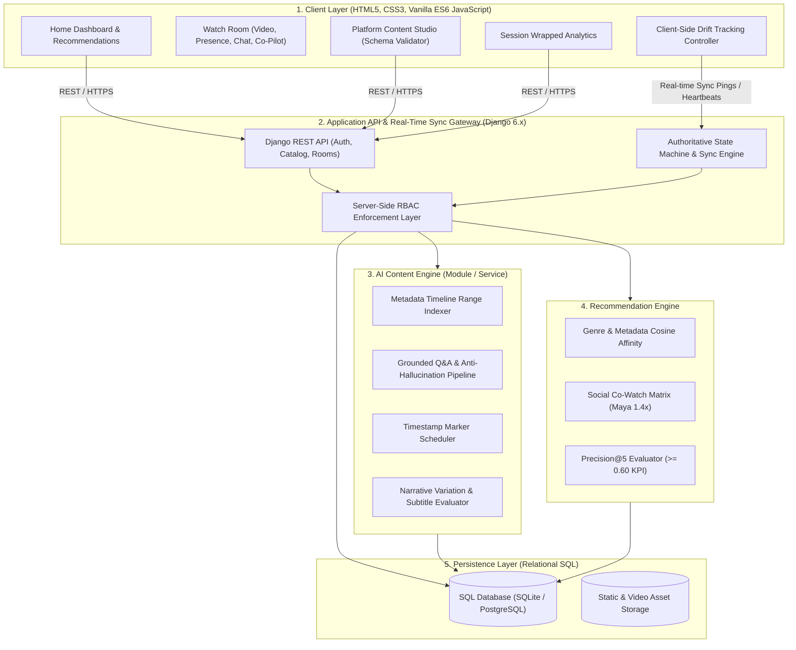

# System Architecture & Technical Design

This document details the software architecture, synchronization mechanics, and real-time state machine for **Netflix Watch Spaces** (AI-Driven Social Watch Spaces & Interactive Content Engine).

---

## 1. High-Level Architectural Layers

The system is organized into five decoupled layers adhering to clean architecture principles:



---

## 2. Real-Time Playback Synchronization & Drift Correction

### 2.1 Authoritative Host State Machine
Group playback is governed by an authoritative state machine owned by the Host and validated on the backend:
- **`Playing`**: Authoritative playback clock advances continuously (`current_playback_ts += delta_t`).
- **`Paused`**: Clock is frozen. Broadcast to all clients with timestamp of pause.
- **`Seeking`**: Host scrubs to a new position; server immediately updates authoritative position and broadcasts micro-seek commands.
- **`Buffering`**: If a viewer experiences temporary stalls, playback for the room continues, and reconnecting clients smoothly micro-seek back to the host.

### 2.2 Drift Correction Algorithm
To ensure the room drift stays strictly **under 250 ms** without jarring restarts:
1. Every client reports its current timestamp `client_ts` along with network Round-Trip Time (`rtt_ms`).
2. Server estimates one-way trip delay (`rtt_ms / 2`) and compares client playback against the authoritative room clock:
   $$\text{drift\_ms} = (\text{client\_ts} - (\text{room\_ts} + \frac{\text{rtt\_sec}}{2})) \times 1000$$
3. Corrective action matrix:
   - **$|\text{drift}| < 100\text{ ms}$**: Tight synchronization. Maintain standard 1.0x playback rate.
   - **$100\text{ ms} \le |\text{drift}| < 250\text{ ms}$**: Mild drift. Gently adjust playback rate to `0.98x` (if ahead) or `1.02x` (if behind) so audio pitch remains natural and desync resolves seamlessly.
   - **$|\text{drift}| \ge 250\text{ ms}$**: Significant drift (e.g. after mid-session join). Execute smooth micro-seek directly to target frame without restarting stream.

```mermaid
sequenceDiagram
    autonumber
    actor Host
    participant Server as Django Sync Engine
    actor Participant as Viewer (Maya)

    Host->>Server: POST /playback {state: "play", positionSeconds: 812.0}
    Note over Server: Verify Host RBAC token
    Server-->>Host: 200 OK (Playback active)

    loop Every 5 seconds (Drift Heartbeat)
        Participant->>Server: POST /sync {clientTs: 812.040, rttMs: 30}
        Server->>Server: Calculate drift = +25ms (< 250ms target)
        Server-->>Participant: 200 OK {action: "maintain", driftMs: 25}
        Note over Participant: UI renders "● In sync · 25 ms"
    end
```

---

## 3. Host Failover & Auto-Promotion Protocol

If the Host loses network connection or closes their browser:
1. Room status transitions to `host_offline`.
2. Master playback is paused to prevent desynchronization for viewers.
3. An on-screen warning banner alerts all participants:
   > *"Your host connection dropped. Playback is paused for everyone. Auto-promoting Maya in 12s."*
4. If the original host does not reconnect within the 12-second grace period, the backend automatically promotes the longest-connected participant (`Maya`) to Host.
5. All playback controls and moderation privileges are transferred server-side.

---

## 4. Server-Side Role-Based Access Control (RBAC)

Security is strictly enforced on the server rather than merely hiding buttons in the UI:
- **`viewer`**: Can join rooms, stream synchronized playback, participate in real-time chat, vote in variation polls, and ask questions to the AI Co-Pilot. Rejected (403 Forbidden) if attempting to alter authoritative playback, mute participants, or publish schemas.
- **`host`**: Owns the watch space. Can play, pause, seek, mute participants, remove disruptive viewers, lock the room, pin trivia cards, and open variation voting.
- **`admin`**: System administrator. Has full access to the Platform Content Studio, can create/edit catalog titles, and can validate and publish timeline metadata schemas.
