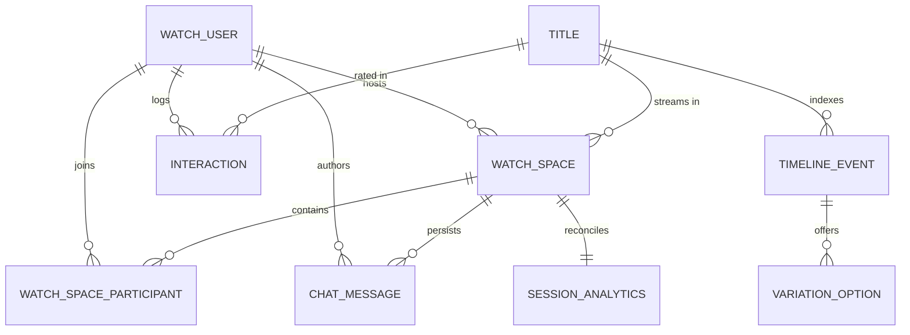

# Relational SQL Database Schema Specification

This document details the relational SQL database schema for **Netflix Watch Spaces** (AI-Driven Synchronized Social Viewing & Content Engine). The schema implements the entity model defined in PRD Section 7.2.2 with standard SQL tables, foreign key constraints, and performance indexes.

---

## 1. Entity-Relationship Overview



---

## 2. Table Specifications & SQL DDL

### 2.1 Table: `spaces_watchuser`
Stores user identity, roles for Role-Based Access Control (RBAC), display profiles, and preferences.

| Column | Data Type | Constraints | Description |
|---|---|---|---|
| `id` | `VARCHAR(50)` | `PRIMARY KEY` | Unique user identifier (e.g., `u_501`, `u_maya`) |
| `email` | `VARCHAR(254)` | `UNIQUE, NOT NULL, INDEX` | Unique login email |
| `password_hash` | `VARCHAR(255)` | `NOT NULL` | PBKDF2/SHA-256 password hash |
| `display_name` | `VARCHAR(100)` | `NOT NULL` | User full name (e.g., "Priya Raman") |
| `role` | `VARCHAR(20)` | `NOT NULL, DEFAULT 'viewer'` | Role: `'viewer'`, `'host'`, or `'admin'` |
| `subtitle_locale` | `VARCHAR(20)` | `NOT NULL, DEFAULT 'en-US'` | User's preferred subtitle locale |
| `avatar_initials` | `VARCHAR(10)` | `NOT NULL, DEFAULT 'PR'` | Avatar abbreviation |
| `avatar_color` | `VARCHAR(30)` | `NOT NULL, DEFAULT '#E50914'` | UI accent color for avatar chip |
| `created_at` | `DATETIME` | `NOT NULL` | Registration timestamp |

```sql
CREATE TABLE spaces_watchuser (
    id VARCHAR(50) PRIMARY KEY,
    email VARCHAR(254) NOT NULL UNIQUE,
    password_hash VARCHAR(255) NOT NULL,
    display_name VARCHAR(100) NOT NULL,
    role VARCHAR(20) NOT NULL DEFAULT 'viewer',
    subtitle_locale VARCHAR(20) NOT NULL DEFAULT 'en-US',
    avatar_initials VARCHAR(10) NOT NULL DEFAULT 'PR',
    avatar_color VARCHAR(30) NOT NULL DEFAULT '#E50914',
    created_at DATETIME NOT NULL
);
CREATE INDEX spaces_user_email_idx ON spaces_watchuser(email);
```

---

### 2.2 Table: `spaces_title`
Represents movies and episodic titles available in the catalog.

| Column | Data Type | Constraints | Description |
|---|---|---|---|
| `id` | `VARCHAR(50)` | `PRIMARY KEY` | Title identifier (e.g., `t_1001`) |
| `name` | `VARCHAR(200)` | `NOT NULL` | Title name (e.g., "The Salt Road") |
| `episode_info` | `VARCHAR(200)` | `NOT NULL` | Season & Episode subtitle (e.g. `S1 · E4 "The Crossing"`) |
| `duration_seconds`| `INTEGER` | `NOT NULL` | Total runtime in seconds (e.g. 2730 = 45m 30s) |
| `video_asset_url` | `VARCHAR(500)` | `NULL` | Video streaming asset path/URL |
| `synopsis` | `TEXT` | `NOT NULL` | Plot summary description |
| `genres` | `JSON` | `NOT NULL` | JSON array of genres `["Thriller", "Neo-Noir", "Crime"]` |
| `match_percentage`| `INTEGER` | `NOT NULL, DEFAULT 90` | Baseline match rating (e.g. 97%) |
| `rating_tag` | `VARCHAR(50)` | `DEFAULT 'TV-MA'` | Content rating badge |
| `year` | `INTEGER` | `DEFAULT 2026` | Release year |
| `episodes_count` | `INTEGER` | `DEFAULT 6` | Total episode count |
| `resolution_badge`| `VARCHAR(20)` | `DEFAULT '4K'` | Resolution badge |
| `poster_url` | `VARCHAR(500)` | `NULL` | Poster asset URL |
| `backdrop_url` | `VARCHAR(500)` | `NULL` | Hero banner asset URL |
| `is_published` | `BOOLEAN` | `DEFAULT TRUE` | Whether timeline is published |
| `schema_version` | `VARCHAR(20)` | `DEFAULT 'v1.2'` | Schema version of ingested timeline |
| `created_at` | `DATETIME` | `NOT NULL` | Record creation timestamp |

---

### 2.3 Table: `spaces_timelineevent`
Range-indexed metadata timeline powering the real-time AI Co-Pilot, trivia triggers, and glossary lookups.

| Column | Data Type | Constraints | Description |
|---|---|---|---|
| `id` | `VARCHAR(50)` | `PRIMARY KEY` | Event ID (e.g. `evt_2276`, `evt_3118`) |
| `title_id` | `VARCHAR(50)` | `FOREIGN KEY REFERENCES spaces_title(id)` | Title reference |
| `ts_seconds` | `INTEGER` | `NOT NULL, INDEX` | Exact playback timestamp in seconds |
| `event_type` | `VARCHAR(30)` | `NOT NULL, INDEX` | `'trivia'`, `'character'`, `'variation_point'`, `'glossary'` |
| `content` | `TEXT` | `NOT NULL` | Fact, glossary definition, or trivia body |
| `source_id` | `VARCHAR(50)` | `NULL` | Timeline source provenance marker |
| `character_name` | `VARCHAR(100)` | `NULL` | Character on-screen (e.g., "Ilse", "Detective Rios") |
| `location` | `VARCHAR(200)` | `NULL` | Scene setting (e.g. "Salar de Uyuni · night exterior") |
| `payload` | `JSON` | `NULL` | Extensible metadata payload |
| `created_at` | `DATETIME` | `NOT NULL` | Event ingestion timestamp |

**Compound Indexes:**
- `INDEX (title_id, ts_seconds)`: Optimizes range lookups (`WHERE ts_seconds BETWEEN ? AND ?`).
- `INDEX (title_id, event_type)`: Fast filtering by type in Content Studio.

---

### 2.4 Table: `spaces_variationoption`
Pre-approved narrative branch and localized subtitle choices associated with a `variation_point` timeline event.

| Column | Data Type | Constraints | Description |
|---|---|---|---|
| `id` | `INTEGER` | `PRIMARY KEY AUTOINCREMENT` | Unique option identifier |
| `timeline_event_id`| `VARCHAR(50)` | `FOREIGN KEY REFERENCES spaces_timelineevent(id)` | Associated timeline event |
| `variation_id` | `VARCHAR(50)` | `NOT NULL` | Logical variation identifier (e.g. `v_01`) |
| `option_key` | `VARCHAR(10)` | `NOT NULL` | Option identifier (`'a'`, `'b'`) |
| `label` | `VARCHAR(300)` | `NOT NULL` | Dialogue line or option label |
| `asset_ref` | `VARCHAR(200)` | `NULL` | Subtitle/audio track asset pointer |
| `vote_count` | `INTEGER` | `DEFAULT 0` | Live vote tally |

---

### 2.5 Table: `spaces_watchspace`
Authoritative state of a synchronized group viewing session.

| Column | Data Type | Constraints | Description |
|---|---|---|---|
| `id` | `VARCHAR(50)` | `PRIMARY KEY` | Room identifier (e.g. `ws_88231`) |
| `invite_code` | `VARCHAR(20)` | `UNIQUE, NOT NULL, INDEX` | Shareable join code (e.g. `NX-4Q7K`) |
| `title_id` | `VARCHAR(50)` | `FOREIGN KEY REFERENCES spaces_title(id)` | Title being watched |
| `host_id` | `VARCHAR(50)` | `FOREIGN KEY REFERENCES spaces_watchuser(id)` | Current authoritative Host user |
| `room_name` | `VARCHAR(200)` | `NOT NULL` | Display room name (e.g. "Friday Noir Club") |
| `status` | `VARCHAR(20)` | `NOT NULL, DEFAULT 'live'` | `'scheduled'`, `'live'`, `'ended'` |
| `max_participants`| `INTEGER` | `NOT NULL, DEFAULT 15` | Room capacity ceiling (up to 50) |
| `ai_verbosity` | `VARCHAR(20)` | `NOT NULL, DEFAULT 'normal'` | `'minimal'`, `'normal'`, `'chatty'` |
| `voting_enabled` | `BOOLEAN` | `NOT NULL, DEFAULT TRUE` | Whether group voting is active |
| `privacy` | `VARCHAR(20)` | `NOT NULL, DEFAULT 'invite_only'` | `'invite_only'` or `'public'` |
| `current_playback_ts`| `FLOAT` | `NOT NULL, DEFAULT 0.0` | Authoritative room clock position (seconds) |
| `is_playing` | `BOOLEAN` | `NOT NULL, DEFAULT TRUE` | Master play/pause state |
| `is_locked` | `BOOLEAN` | `NOT NULL, DEFAULT FALSE` | Host lock against new joiners |
| `active_variation`| `JSON` | `NULL` | Applied variations map `{"v_01": "b"}` |
| `active_vote` | `JSON` | `NULL` | Live voting state and countdown |
| `created_at` | `DATETIME` | `NOT NULL` | Session launch timestamp |
| `ended_at` | `DATETIME` | `NULL` | Session end timestamp |

---

### 2.6 Table: `spaces_watchspaceparticipant`
Join table recording user presence, connection health, and client sync drift.

| Column | Data Type | Constraints | Description |
|---|---|---|---|
| `id` | `INTEGER` | `PRIMARY KEY AUTOINCREMENT` | Participant session ID |
| `watch_space_id` | `VARCHAR(50)` | `FOREIGN KEY REFERENCES spaces_watchspace(id)` | Room reference |
| `user_id` | `VARCHAR(50)` | `FOREIGN KEY REFERENCES spaces_watchuser(id)` | User reference |
| `role` | `VARCHAR(20)` | `DEFAULT 'participant'` | `'host'` or `'participant'` |
| `is_muted` | `BOOLEAN` | `DEFAULT FALSE` | Host mute status |
| `connection_quality`| `VARCHAR(20)`| `DEFAULT 'Excellent'` | Network health badge |
| `drift_ms` | `INTEGER` | `DEFAULT 37` | Measured playback drift in ms |
| `last_heartbeat` | `DATETIME` | `NOT NULL` | Last sync ping timestamp |
| `joined_at` | `DATETIME` | `NOT NULL` | Join timestamp |
| `left_at` | `DATETIME` | `NULL` | Leave timestamp |

**Constraint:** `UNIQUE (watch_space_id, user_id)`

---

### 2.7 Table: `spaces_chatmessage`
Message log preserving user chat, grounded AI Co-Pilot responses, and system events.

| Column | Data Type | Constraints | Description |
|---|---|---|---|
| `id` | `INTEGER` | `PRIMARY KEY AUTOINCREMENT` | Message ID |
| `watch_space_id` | `VARCHAR(50)` | `FOREIGN KEY REFERENCES spaces_watchspace(id)` | Room reference |
| `user_id` | `VARCHAR(50)` | `NULLABLE, FOREIGN KEY spaces_watchuser(id)` | Author (NULL for AI/system) |
| `msg_type` | `VARCHAR(20)` | `NOT NULL, DEFAULT 'chat'` | `'chat'`, `'ai_answer'`, `'system'` |
| `body` | `TEXT` | `NOT NULL` | Message body |
| `ts_seconds` | `INTEGER` | `NOT NULL, DEFAULT 0` | Playback timestamp when sent |
| `is_pinned` | `BOOLEAN` | `DEFAULT FALSE` | Pinned by Host |
| `source_events` | `JSON` | `NULL` | Cited timeline source IDs `["evt_2291", "evt_2344"]` |
| `is_grounded` | `BOOLEAN` | `DEFAULT FALSE` | Whether answer is verified from metadata |
| `latency_ms` | `INTEGER` | `DEFAULT 0` | Measured generation latency (ms) |
| `created_at` | `DATETIME` | `NOT NULL` | Wall-clock timestamp |

---

### 2.8 Table: `spaces_interaction`
Feeds the hybrid recommendation model with explicit ratings, watch completion percentages, and social co-watching graphs.

| Column | Data Type | Constraints | Description |
|---|---|---|---|
| `id` | `INTEGER` | `PRIMARY KEY AUTOINCREMENT` | Interaction ID |
| `user_id` | `VARCHAR(50)` | `FOREIGN KEY spaces_watchuser(id)` | User reference |
| `title_id` | `VARCHAR(50)` | `FOREIGN KEY spaces_title(id)` | Title reference |
| `watched_seconds` | `INTEGER` | `DEFAULT 0` | Seconds watched |
| `completed` | `BOOLEAN` | `DEFAULT FALSE` | Completion flag |
| `rating` | `INTEGER` | `DEFAULT 5` | User rating (1 to 5) |
| `co_watched_with` | `JSON` | `NULL` | Array of co-viewer user IDs `["u_maya", "u_dev"]` |
| `created_at` | `DATETIME` | `NOT NULL` | Log creation timestamp |

---

### 2.9 Table: `spaces_sessionanalytics`
Persists the post-session "Session Wrapped" summary report.

| Column | Data Type | Constraints | Description |
|---|---|---|---|
| `id` | `INTEGER` | `PRIMARY KEY AUTOINCREMENT` | Analytics report ID |
| `watch_space_id` | `VARCHAR(50)` | `UNIQUE, FOREIGN KEY spaces_watchspace(id)` | Room reference |
| `watch_time_seconds`| `INTEGER` | `DEFAULT 6120` | Total session watch time (e.g. 1h 42m) |
| `peak_viewers` | `INTEGER` | `DEFAULT 8` | Peak concurrent participants |
| `ai_questions_count`| `INTEGER` | `DEFAULT 23` | Total questions asked to Co-Pilot |
| `trivia_cards_count`| `INTEGER` | `DEFAULT 14` | Total trivia cards surfaced |
| `chat_messages_count`| `INTEGER` | `DEFAULT 186` | Total chat messages |
| `sync_drift_avg_ms`| `INTEGER` | `DEFAULT 31` | Average sync drift (target < 100ms) |
| `sync_drift_peak_ms`| `INTEGER` | `DEFAULT 68` | Peak sync drift (target < 250ms) |
| `variations_applied`| `JSON` | `NULL` | Summary of applied variations |
| `top_ai_moments` | `JSON` | `NULL` | Top 3 Q&A moments with citations & latency |
| `chat_activity_distribution`| `JSON` | `NULL` | 10-minute binned message distribution |
| `created_at` | `DATETIME` | `NOT NULL` | Report generation timestamp |
